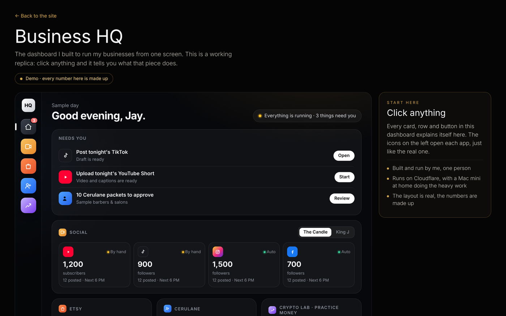
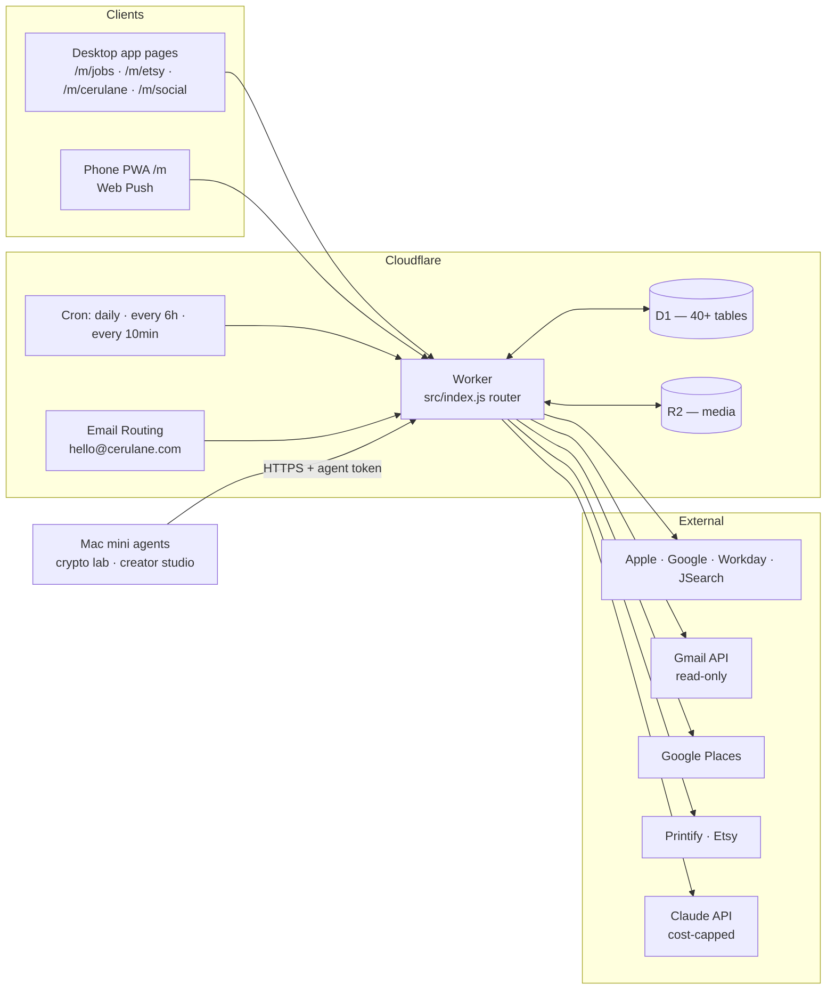
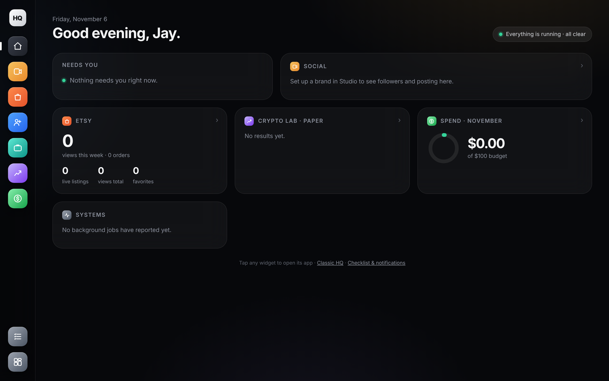
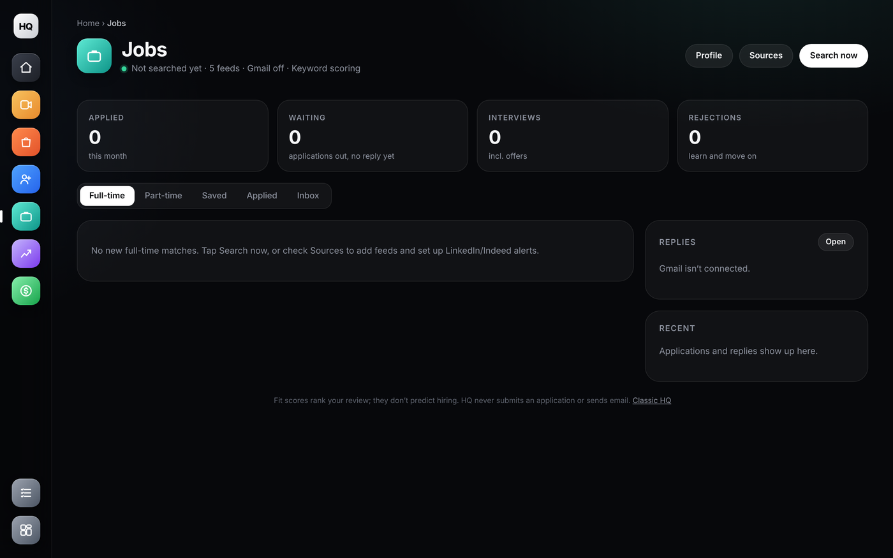
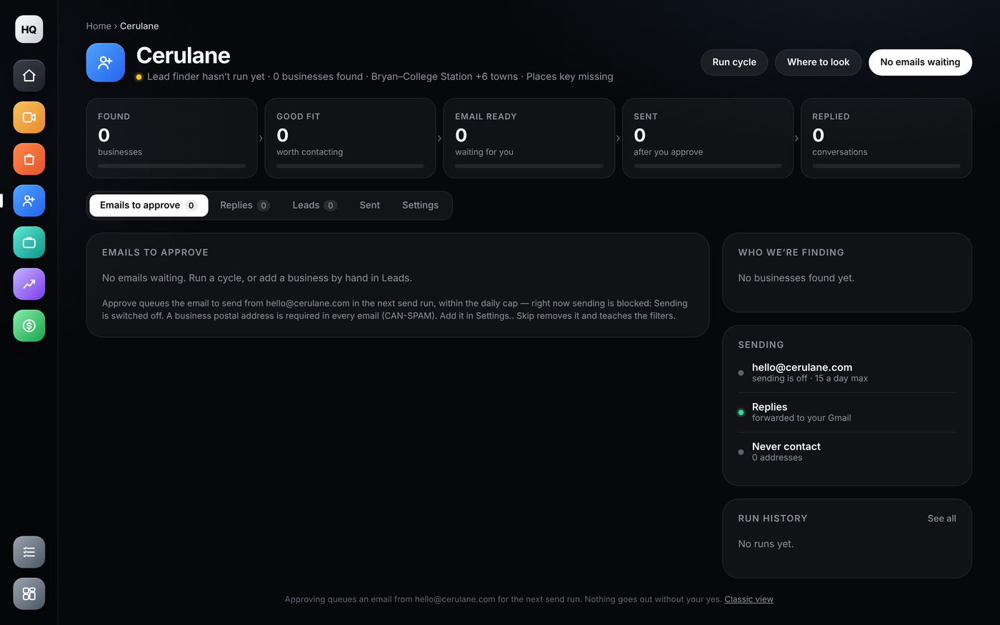
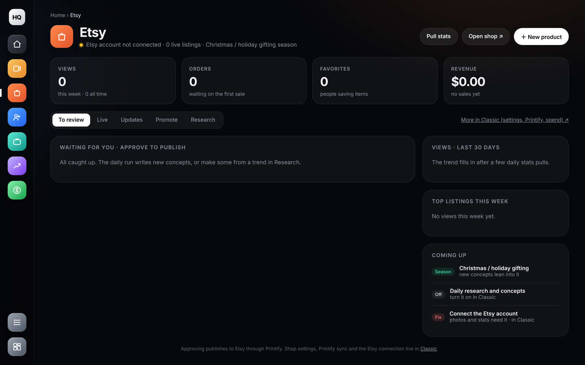
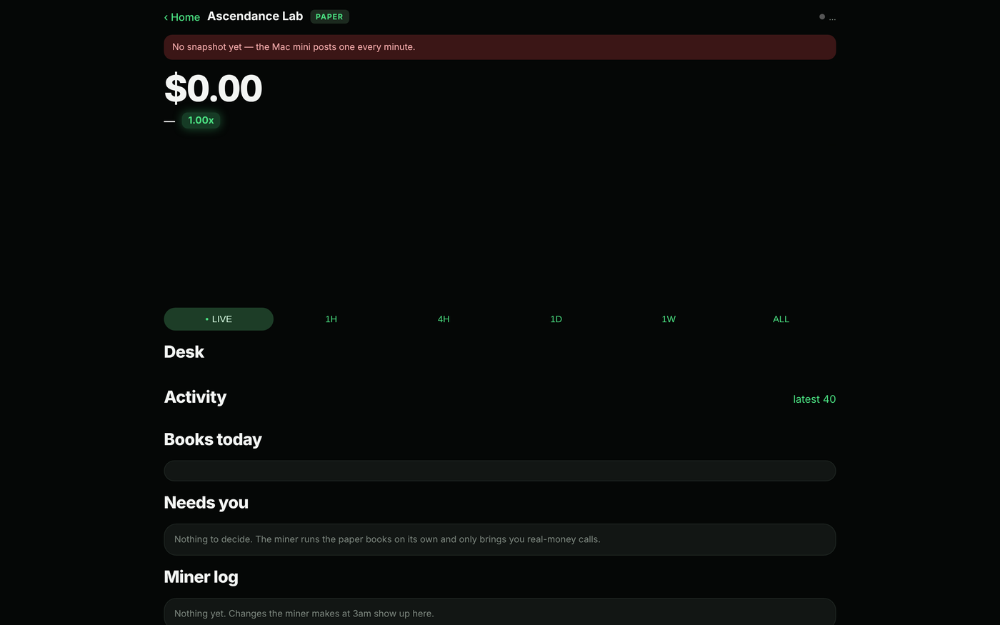
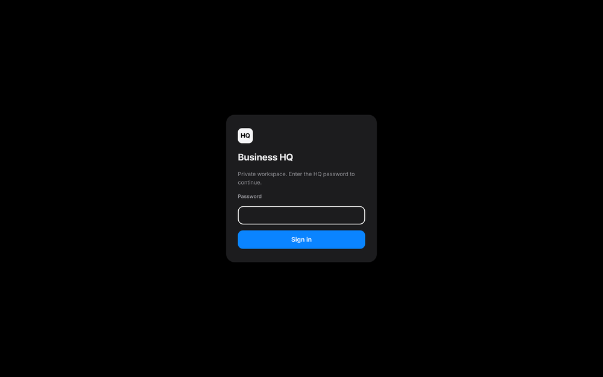

# Business HQ — one dashboard that runs four businesses

<p align="center"></p>

<p align="center"><a href="https://jaamihasan.com/hq-tour.html"><b>▶ Click-through demo</b></a> (a working replica with made-up numbers — click anything and it explains itself)</p>

Business HQ is the private command center I built to run everything I do outside my day job from one screen: a job search, a web agency, a print-on-demand shop, a social posting pipeline, and a crypto paper-trading lab. It runs as a single **Cloudflare Worker + D1** app with scheduled automation, and it follows one rule everywhere:

> **The software does the research, drafting and bookkeeping. A human approves anything that touches the outside world.**

Nothing is posted, emailed, published, applied to, or bought without an explicit approve click. That constraint shaped the whole architecture.

This repo is a **curated public subset** of the private `business-hq` codebase: the architecture, the security and scoring modules, their tests, the schema, and screenshots. The full app (≈6k lines of Worker code, 28 test files, 80 merged PRs in its first three weeks) stays private because it holds my own business data.

## What it does

| Module | What runs on its own | What waits for me |
|---|---|---|
| **Jobs** | Pulls postings from Apple Jobs, Google Careers, Workday tenants (Texas A&M System) and JSearch (LinkedIn/Indeed) every 6 h; scores each lead 0–100 against my profile; drafts a tailored résumé per job; reads job-related Gmail (read-only scope) to track replies | Approving an application packet; *I* submit on the employer's portal, then record "submitted" |
| **Cerulane** (web agency) | Finds local businesses without a decent website via Google Places, audits what they have, builds a mockup and drafts a personal intro email | Approving each email before it leaves `hello@cerulane.com`; replies route back into HQ |
| **Etsy** (print-on-demand) | Daily trend scout, niche scoring, concept drafting, design rendering, Printify product creation with mockups, listing refresh proposals, daily stats pull | Approving a concept, a listing, a title/price change |
| **Social / Studio** | Video library, posting calendar, platform health checks every 10 min, captions | Posting (manual for platforms whose API approval is pending) |
| **Crypto Lab** | A Mac mini runs the paper-trading engine ([ascendance-lab](https://github.com/yungking304/ascendance-lab-showcase)) and mirrors its live snapshot into HQ every minute | Any switch to real money |
| **Today / phone** | Installable PWA with a daily checklist that rolls forward, "needs you" counts, and Web Push alerts | — |
| **Spend** | Every AI call and external API cost is written to an expense ledger with a monthly budget and a hard AI cap | Raising a budget |

## Architecture



**One Worker, many modules.** `src/index.js` is a flat router: each business is a module exporting `handleX(req, env)` for its API and `scheduledX(env)` for its cron slice. Modules share the D1 database, the expense ledger and the auth layer, nothing else. Adding a business means adding one file and two lines in the router.

**Additive schema.** Every module creates its own tables with `CREATE TABLE IF NOT EXISTS` on first use. The database has never needed a reset or a destructive migration; new features ship as new tables or new columns with defaults.

**Approval queues, not automation.** Each pipeline ends in a row with a status (`draft → approved → published`, `found → email_ready → sent`). The UI is mostly views over those queues. The scheduled job never advances past "ready for review" on its own.

**Cost control as a first-class feature.** AI spend is recorded per call with a soft and hard monthly limit; when the hard limit is hit, the model-backed paths fall back to deterministic heuristics (the job scorer, for instance, has a keyword version that returns the same shape as the model version).

## Security design (`src/auth.js`, `src/push.js`)

- One owner password, stored only as a **PBKDF2-SHA256 hash** in a Worker secret; a timing-safe compare; the hash is checkable before use so a bad config fails loudly.
- **Server-side sessions in D1.** The browser holds only a random 256-bit token in a `__Host-` `HttpOnly` `Secure` `SameSite=Lax` cookie, so sign-out really revokes. Absolute 7-day lifetime, 24-hour idle timeout.
- **Rate limiting** on failed sign-ins: 5 per IP or 40 globally per 15 minutes → `429`.
- Mutations require a matching browser `Origin`; the page ships a strict Content-Security-Policy (`default-src 'none'`, no inline script).
- **Web Push implemented directly on WebCrypto** — VAPID (RFC 8292) JWT signing with ES256 and aes128gcm payload encryption (RFC 8291) — with an allow-list of real push-service hosts so the Worker can't be turned into an open POST proxy.
- External job feeds are read through a fixed host allow-list (`src/job-boards.js`); user-supplied tokens select a path, never a host.
- Gmail is connected with the single `gmail.readonly` scope; the refresh token is AES-GCM encrypted in D1 with a Worker-only key and never returned to the browser.

## Testing

The private repo runs **156 tests across 28 files** with `node --test`, against a SQLite-backed D1 emulation and mocked external APIs. They cover deduplication, approval/version gates, encrypted token storage, OAuth replay/scope rejection, rate limiting, push payload encryption, and that each cron slice still creates the rows it should. Three of those files are included here as examples.

## Screens

| Home — every business at a glance | Jobs — tiles, four numbers, one card per lead |
|---|---|
|  |  |

| Cerulane — outreach desk | Etsy — review queue and live stats |
|---|---|
|  |  |

| Crypto Lab — paper desk mirrored from the Mac mini | Sign-in |
|---|---|
|  |  |

*Screens above are the real app running locally on an empty database.*

## What's in this repo

```
src/
  index.js        the router — shows how modules plug in (imports its siblings from the private repo)
  auth.js         password hashing, D1 sessions, rate limiting
  push.js         VAPID + aes128gcm Web Push on WebCrypto
  job-score.js    lead scoring: model-backed with a heuristic fallback of the same shape
  job-boards.js   fixed-host allow-list for public ATS feeds
  shell.js        the shared app-page shell (dock, header, tabs, KPI tiles)
tests/            the matching test files
schema.sql        the original five tables; the rest are created by their modules on first use
wrangler.toml     bindings, crons and budget vars (IDs redacted)
docs/             screenshots
```

This subset is for reading, not running — `index.js` imports modules that live in the private repo.

## Stack

Cloudflare Workers · D1 (SQLite) · R2 · Cron Triggers · Email Routing / Email Sending · WebCrypto · Web Push · Gmail API · Google Places · Printify & Etsy APIs · Claude API · Node test runner · Python (Mac mini agents)

---

**Jaami Hasan** · [jaamihasan.com](https://jaamihasan.com) · [LinkedIn](https://www.linkedin.com/in/jaamihasan) · [GitHub](https://github.com/yungking304)
